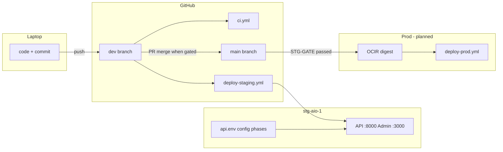

# Developer release flow (laptop → staging → prod readiness)

**Repo:** `svasthol/puja_platform` · **Staging host:** `stg-aio-1` (`140.245.245.201`)  
**Prod fleet:** not live yet — this doc defines how we operate **now** on staging and what we wire before prod.

| Related doc | Role |
|-------------|------|
| [`STAGING_DEPLOY_PIPELINE.md`](./STAGING_DEPLOY_PIPELINE.md) | Deploy-staging workflow + VM scripts |
| [`STAGING_CONFIG_ROLLOUT.md`](./STAGING_CONFIG_ROLLOUT.md) | Ordered env/config on staging (S3, catalog, KYC, …) |
| [`STG_TO_PROD_PIPELINE.md`](./STG_TO_PROD_PIPELINE.md) | Promotion model + **STG-GATE** before prod spend |
| [`STAGING_GITHUB_SETUP.md`](./STAGING_GITHUB_SETUP.md) | GitHub Environment `staging` secrets |
| [`STAGING_DEPLOY_INCIDENTS.md`](./STAGING_DEPLOY_INCIDENTS.md) | Log STG breaks → prod guardrails |
| [**`GITHUB_STG_PROD_DEPLOYMENT_DIAGRAM.md`**](./GITHUB_STG_PROD_DEPLOYMENT_DIAGRAM.md) | **Mermaid diagrams** (end-to-end, sequence, workflows) |

---

## 1. Branch model (single procedure)

| Branch | Who pushes | What runs automatically | What it means |
|--------|------------|-------------------------|---------------|
| **`dev`** | Developers (daily) | **CI** on push/PR; **Deploy staging** on push to `dev` (app paths) | **Integration + live staging** — `stg-aio-1` tracks `origin/dev` |
| **`main`** | **Promotion only** (PR merge from `dev`) | **CI** on push/PR | **Release line** — same SHA we will ship to prod; default branch for new Actions workflows |
| **Feature branches** (optional) | Developer | **CI** when PR opened to `dev` or `main` | Short-lived; merge into `dev` |

**Rules**

1. Routine work lands on **`dev`** first; staging proves it.
2. **`main` is not a second dev branch** — merge `dev` → `main` only after staging checks for that release slice (see §5).
3. **No manual `git pull` on prod app nodes** (future). Staging may be reset with `git reset --hard origin/dev` if the VM clone drifted — not a substitute for fixing deploy.
4. **Secrets never in git** — laptop `.env`, VM `/etc/mana-guruji/api.env`, GitHub Environment secrets only.



---

## 2. Daily developer path (dev → staging)

### 2.1 Local

```bash
git checkout dev
git pull origin dev
# edit, test locally (Postgres/Redis; S3 optional — empty S3_ENDPOINT_URL = real AWS if configured)
git add … && git commit -m "feat: …"
git push origin dev
```

Optional: open **PR `feature/*` → `dev`** for review; merge on GitHub when **CI** is green.

### 2.2 What GitHub does (automatic)

| Step | Workflow | Pass criteria |
|------|----------|---------------|
| 1 | [`ci.yml`](../../.github/workflows/ci.yml) | linux/arm64 runtime + preflight imports |
| 2 | [`deploy-staging.yml`](../../.github/workflows/deploy-staging.yml) | SSH or self-hosted runner → `remote_staging_deploy.sh` → migrate (if in component) → restart API/Celery → optional admin rebuild |

**If deploy did not run** (docs-only change): **Actions → Deploy staging → Run workflow** → `git_ref=dev`, `component=full` (or `backend_only` / `admin_only`).

### 2.3 Verify on staging (developer or ops)

| Check | Command / URL |
|-------|----------------|
| API live | `curl -sS http://140.245.245.201:8000/health/live` |
| Ready (DB+Redis) | `curl -sS http://140.245.245.201:8000/health/ready` |
| Admin | `http://140.245.245.201:3000` (login; CORS in `ALLOWED_ORIGINS`) |

**Config changes** (S3, Razorpay, KYC URLs) are **not** in git — edit `/etc/mana-guruji/api.env` on the VM, restart units, then run the verify step for that phase in [`STAGING_CONFIG_ROLLOUT.md`](./STAGING_CONFIG_ROLLOUT.md).

---

## 3. Staging config vs code (two tracks)

| Track | Where | When |
|-------|--------|------|
| **Application code** | `git push dev` → Deploy staging | Every feature/fix |
| **Staging secrets & URLs** | `/etc/mana-guruji/api.env`, `admin.env` | Phases in **STAGING_CONFIG_ROLLOUT** (Phase 0–6) |
| **Manual workflow smokes** | GitHub Actions (runner on VM) | After env change or before marking PM row done |

Example (Phase 1 — done): `scripts/verify_staging_storage.py --strict` on VM; optional **Staging storage smoke** workflow after workflow file is on **`main`** (see §5.2).

---

## 4. Manual GitHub workflows (staging toolbox)

Run from **Actions** when the scenario applies (most are `workflow_dispatch`):

| Workflow | Use when |
|----------|----------|
| **Deploy staging** | Redeploy, pick `component`, pin `git_ref` |
| **Staging storage smoke** | After S3 block in `api.env` |
| **DB verify** | After migrations or schema doubt |
| **Redis ensure staging** | After Redis host/URL change |
| **DB dev staging parity** | Deep compare dev vs staging DB (secret `DEV_DATABASE_URL`) |

**Note:** Workflows appear in the Actions sidebar when their YAML exists on the repo **default branch** (`main`). Until you promote `dev` → `main`, use the direct URL  
`https://github.com/svasthol/puja_platform/actions/workflows/<file>.yml`  
and select branch **`dev`**, or run the same script on the VM.

---

## 5. Promotion `dev` → `main` (prod readiness, no prod VM yet)

Even without prod, merge to **`main` on a rhythm** so:

- Release SHA is obvious for auditors and PM.
- New `.github/workflows/*` show up in Actions.
- Future **deploy-prod** pins the same commit/digest staging already ran.

### 5.1 When to open PR `dev` → `main`

| Trigger | Example |
|---------|---------|
| **Milestone** | Phase 1 storage complete, Phase 2 catalog complete |
| **Weekly / biweekly** | Stable `dev` at end of sprint |
| **Before prod IaC** | **STG-GATE** criteria in [`STG_TO_PROD_PIPELINE.md`](./STG_TO_PROD_PIPELINE.md) |

### 5.2 PR checklist (copy into PR description)

- [ ] **CI** green on PR (`dev` → `main`)
- [ ] **Deploy staging** succeeded for the **same commits** on `dev` (or manual deploy with that `git_ref`)
- [ ] Staging **health/ready** OK
- [ ] Relevant **STG-CFG-*** / config phase verify steps passed (link PM rows)
- [ ] Any new env vars documented in `deploy/env/staging.api.env.example` + [`ENV_STAGING_REFERENCE.md`](./ENV_STAGING_REFERENCE.md)
- [ ] Incidents logged in [`STAGING_DEPLOY_INCIDENTS.md`](./STAGING_DEPLOY_INCIDENTS.md) if anything broke during prove-out
- [ ] Optional: tag after merge (`git tag stg-YYYY-MM-DD && git push origin stg-YYYY-MM-DD`)

### 5.3 After merge to `main`

1. Run manual smokes once on the release line (storage, db-verify as needed).
2. Update [`Mana_Guruji_OCI_PM_Tracker_Staging.csv`](./project_pm/Mana_Guruji_OCI_PM_Tracker_Staging.csv).
3. **Do not** point staging VM at `main` unless you intentionally change deploy — **staging stays on `dev`** until we define a `staging` release branch (not planned today).

---

## 6. Prod readiness (plan only — fleet TBD)

When prod exists, **no new process** — only more gates:

| Stage | Action |
|-------|--------|
| **STG-GATE** | STG-S6, VAL-004, VAL-001, STG-CFG-004..005, INC-REVIEW — see [`STG_TO_PROD_PIPELINE.md`](./STG_TO_PROD_PIPELINE.md) |
| **Build** | `build-push.yml` → OCIR **arm64** image, record **digest** |
| **Deploy** | `deploy-prod.yml` — approval in GitHub Environment `production`, rolling app nodes, migrate on DB role |
| **Config** | Vault/Ansible from proven staging patterns (`s3_boto.py`, URLs, `%40` in DB URLs) — not console-only on prod |

**Promotion rule:** Prod runs the **same commit or digest** that passed STG-GATE on staging — not a fresh `git pull` on a laptop branch.

---

## 7. One-time GitHub setup (team)

Do once per repo; details in [`STAGING_GITHUB_SETUP.md`](./STAGING_GITHUB_SETUP.md).

| Item | Setting |
|------|---------|
| Environment **`staging`** | `STAGING_HOST`, `STAGING_SSH_*`, optional `STAGING_DEPLOY_MODE=self-hosted` |
| Self-hosted runner on `stg-aio-1` | Labels: `self-hosted`, `Linux`, `ARM64` |
| **Branch protection `main`** (recommended) | Require PR, require **CI** status, no direct push |
| **Branch protection `dev`** (optional) | Require CI on PR; allow maintainers push for hotfixes |
| Environment **`production`** (later) | Approvers + prod secrets only when fleet exists |

---

## 8. Where you are now → Phase 2

| Done | Next |
|------|------|
| Phase 0 baseline, Phase 1 OCI storage + verify on VM | **Phase 2** — `bootstrap_catalog.py`, Admin images ([`STAGING_CONFIG_ROLLOUT.md`](./STAGING_CONFIG_ROLLOUT.md) §2) |
| Code on `dev` @ `7e54401+` | Continue pushing features to **`dev`**; open **`dev` → `main`** PR when you want release line + Actions workflows on default branch |
| CI-006 Actions smoke | After merge brings `staging-storage-smoke.yml` to `main`, or run workflow on `dev` via direct URL |

---

## 9. Anti-patterns (do not)

| Do not | Do instead |
|--------|------------|
| Edit deploy scripts only on VM | Change in git → push `dev` → deploy |
| Duplicate `S3_*` lines in `api.env` | One key pair; see rollout doc |
| Merge `dev` → `main` without staging proof | PR checklist §5.2 |
| Assume Actions sidebar lists all workflows | Merge workflow YAML to `main` or use workflow URL + branch `dev` |
| Hand-build prod servers | STG-GATE + digest deploy (when live) |

*Last updated: 2026-10-24*
