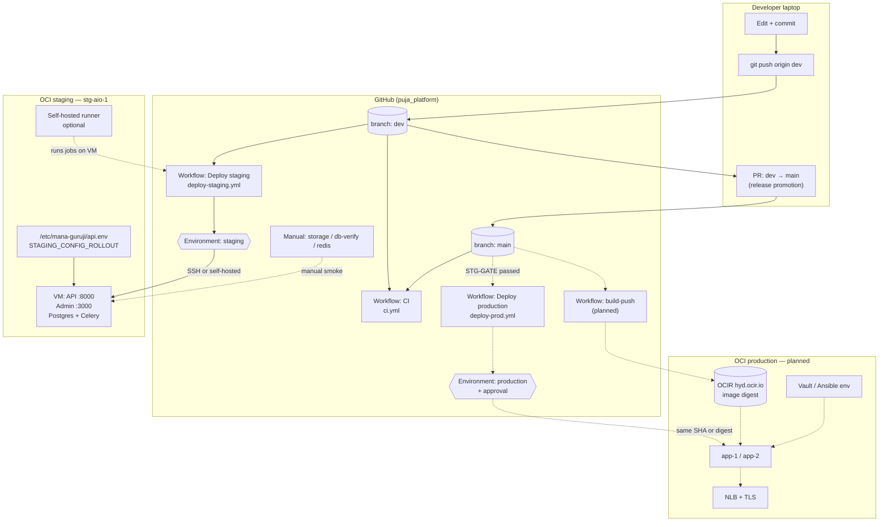
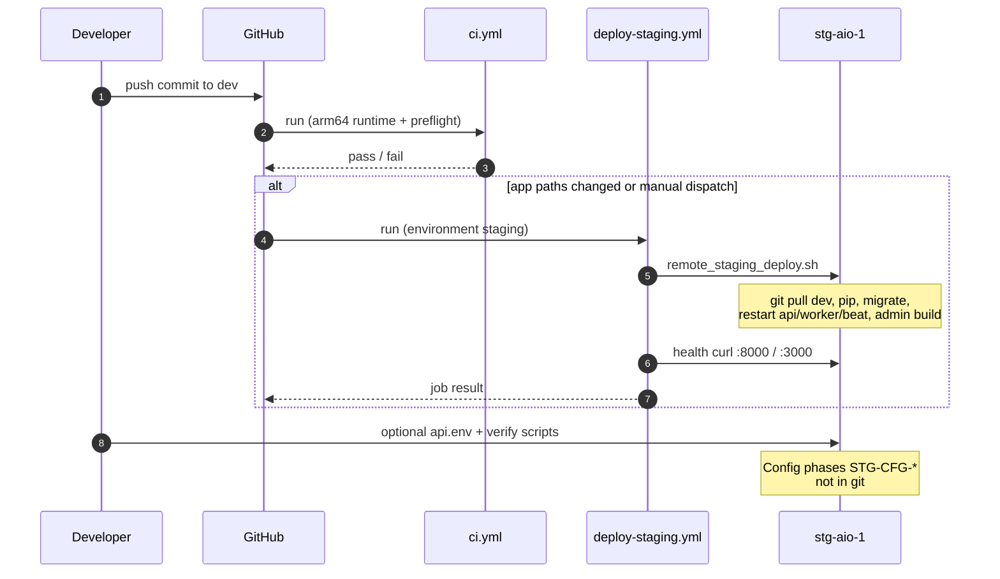
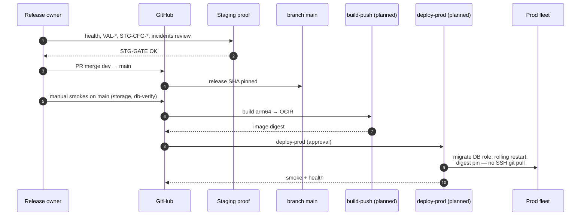
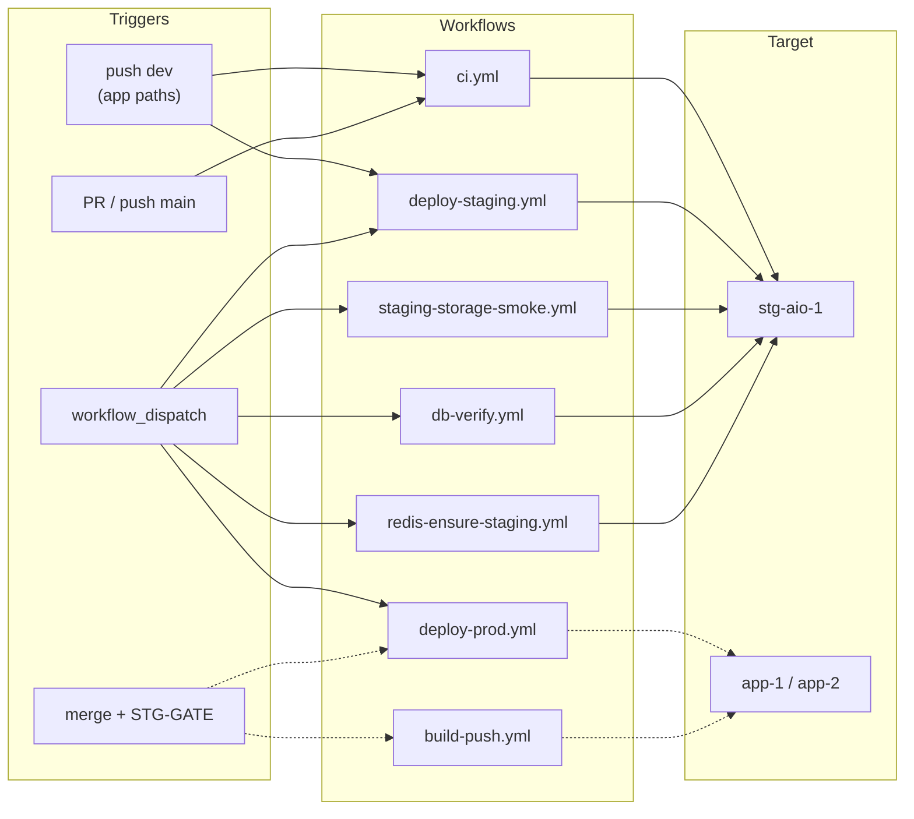
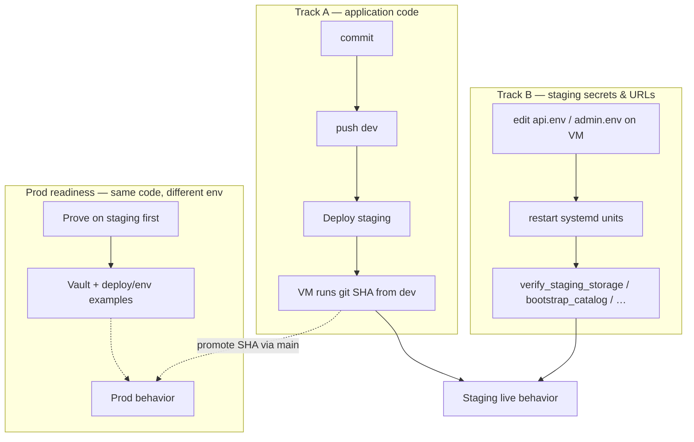

# GitHub → staging → production deployment (diagrams)

**Repo:** `svasthol/puja_platform`  
**Procedure:** [`DEVELOPER_RELEASE_FLOW.md`](./DEVELOPER_RELEASE_FLOW.md) · **Gates:** [`STG_TO_PROD_PIPELINE.md`](./STG_TO_PROD_PIPELINE.md)

Legend: **solid** = operational today · **dashed** = planned before prod cut

---

## 1. End-to-end (branches, Actions, environments)

---

## 2. Sequence — daily path (code to staging)

---

## 3. Sequence — promotion to prod (target)

---

## 4. What runs where (workflow map)

---

## 5. Config vs code (two parallel tracks)

---

## 6. Branch & environment cheat sheet

| Artifact | `dev` | `main` | Staging VM | Prod (planned) |
|----------|-------|--------|------------|----------------|
| Default integration | ✓ push daily | ✗ no direct feature work | tracks **`origin/dev`** | tracks **digest / pinned SHA** |
| **ci.yml** | push / PR | push / PR | — | — |
| **deploy-staging.yml** | auto + manual | manual only if dispatched | deploy target | — |
| **deploy-prod.yml** | — | preflight / future deploy | — | **app-1/2** |
| Secrets for deploy | — | — | `api.env` on VM + GH **staging** env | GH **production** + Vault |
| New Actions in sidebar | if YAML on default branch | **main** lists workflows | runner labels | prod runners TBD |

---

*Render diagrams in GitHub, VS Code (Mermaid), or Cursor markdown preview. Last updated: 2026-10-24*
