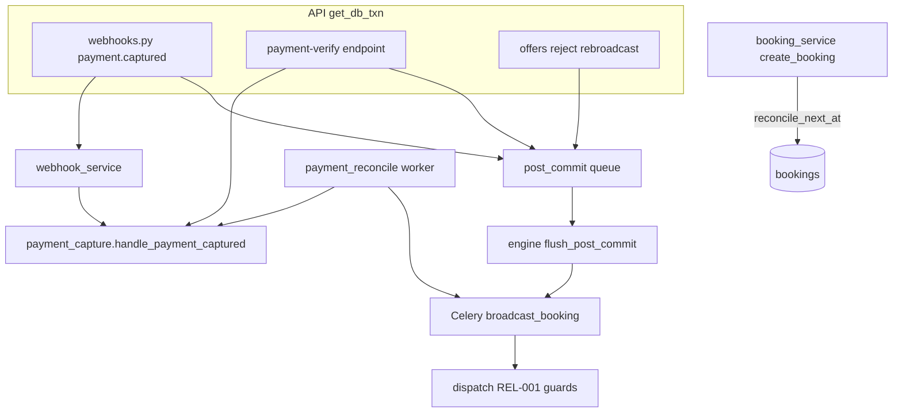

# PR2 execution checklist — post-commit, verify, reconcile

**Parent plan:** Cursor plan `prod_hardening_launch_7e4484af` (Wave 1 PR2)  
**Depends on:** PR #14 merged (`bug/dispatch-payment-guards` — REL-001/003/004/016 + migration_037)  
**Branch:** `bug/post-commit-payment-verify` from **`dev`** (never commit on `dev`/`main` directly)  
**Register:** [`PRODUCTION_RELIABILITY_DEFECT_REGISTER.md`](./PRODUCTION_RELIABILITY_DEFECT_REGISTER.md)  
**QA:** [`PRODUCTION_RELIABILITY_QA_MANUAL.md`](./PRODUCTION_RELIABILITY_QA_MANUAL.md) §5 (REL-002 known until PR2)

---

## Why this PR exists (do not skip context)

PR #14 added **`paid_at` / `requested` dispatch guards** (REL-001). The webhook still **`send_task` before DB commit** on `dev` until this PR lands. A fast Celery worker can read `paid_at IS NULL` → **skip dispatch** → no offers until sweep (~30s), or stranded bookings if the task is never retried.

**This PR closes REL-002.** It must ship **before** treating `dev` as production-ready.

---

## Preconditions (gate before coding)

| Step | Action | Why |
|------|--------|-----|
| 1 | `git checkout dev && git pull` | Base = merged PR #14 + #15 |
| 2 | `python scripts/apply_migration_037.py` on **dev DB** | PR1 trigger/payment guards |
| 3 | Optional: `python scripts/apply_migration_039.py` if dispatch posture drifted | Not a substitute for REL-002 |
| 4 | Preflight SQL (each env): `payments` rows with `order_%` keys | Plan preflight — refunds need `pay_` |
| 5 | Confirm Celery worker + beat running against same Redis/DB as API | Dispatch tasks must land |

---

## Scope

### In scope (this PR only)

| REL | Deliverable |
|-----|-------------|
| **REL-002** | Post-commit Celery enqueue + `get_db_txn` flush/discard |
| **REL-015** | `POST /v1/bookings/{id}/payment-verify` + `verify_razorpay_checkout_signature` |
| **REL-005** | migration_038, reconcile scheduler, beat entry, booking `reconcile_next_at` lifecycle |
| **Capture core** | One `payment_capture.handle_payment_captured` used by webhook, verify, reconcile |
| **QA-DISP-002** (small) | `GET /offers`: `urgency` from frozen `booking_class` (not live `lead_hours`) |
| **Tests** | `test_rel_pr2_post_commit.py`, `test_rel_pr2_integration.py` |

### Out of scope (later PRs — do not mix in)

| Item | Reason |
|------|--------|
| MOB-REL-015 Flutter verify | MOB-1 after backend merge + OpenAPI sync |
| REL-006 `bookings.py` dispatch-choice | `DIRECT_BOOKING_ENABLED=False` at MVP |
| PR3 Celery split / RedBeat | Wave 2 |
| REL-013 two-phase `create_order` | PR4 |
| Admin / catalog / KYC unrelated files | Scope creep |

---

## Connectivity map (what touches what)



**Rule:** Any path that flips `payment_pending → requested` must use **the same capture core** and **post-commit** for dispatch enqueue (except reconcile worker, which runs **after** its own txn commit — see below).

---

## File-by-file edits (authoritative)

Complete each row in order where noted. **One concern per commit** inside the branch is OK for review.

### A — REL-002 core (do first)

| File | Exact change | Must not break | Verify |
|------|----------------|----------------|--------|
| `app/db/post_commit.py` | **Add** module: `enqueue_celery_task`, `flush_post_commit`, `discard_post_commit` | Async loop blocking on `send_task` — use `anyio.to_thread.run_sync` | `pytest tests/test_rel_pr2_post_commit.py` |
| `app/db/engine.py` | After successful `session.begin()`, call `flush_post_commit`; on exception, `discard_post_commit` | **All** existing `get_db_txn` write paths (auth, bookings, offers accept/reject, webhooks, admin) | Rollback test: queued task **not** sent |
| `app/api/v1/endpoints/webhooks.py` | Replace `celery_app.send_task` with `post_commit.enqueue_celery_task` for direct/broadcast | Webhook still returns 200; REL-016 `payment.captured` only | Pay test booking → offers &lt; 60s |
| `app/api/v1/endpoints/offers.py` | Replace inline `send_task` on **reject** with `post_commit.enqueue_celery_task` | Reject still returns; rebroadcast only when eligible | Reject offer → next round without txn race |
| `app/api/v1/endpoints/offers.py` | Use `booking_class` for `urgency` (remove live `compute_lead_hours` for list) | Partner modal: instant only when `booking_class=instant` or `urgency_escalated` | Advance Griha → inbox, not urgent sheet |

**Leave unchanged in PR2 (documented deferrals):**

| File | Current behavior | Why defer |
|------|------------------|-----------|
| `app/api/v1/endpoints/bookings.py` dispatch-choice | Pre-commit `send_task` | REL-006; direct booking disabled |
| `app/services/offer_service.py` | Possible `send_task` | Trace grep; only fix if inside `get_db_txn` and dispatch-related |
| `app/services/cancellation_service.py` | `BackgroundTasks` for FCM | Different pattern; already post-response |

### B — Single payment capture core (do before verify/reconcile behavior)

| File | Exact change | Risk if wrong |
|------|----------------|---------------|
| `app/services/payment_capture.py` | **Keep** as SSOT for capture/refund branches (mirror PR1 `webhook_service` logic) | Double refund or skipped dispatch |
| `app/services/webhook_service.py` | **Thin wrapper**: `handle_payment_captured` → delegate to `payment_capture.handle_payment_captured` (or delete duplicate body) | **Never** diverge webhook vs verify vs reconcile |
| `app/workers/payment_reconcile.py` | Call `payment_capture` only; `_enqueue_dispatch` **after** worker txn commits (OK) | Reconcile must not hold row lock during Razorpay HTTP |

**Do not** change REL-004 check-then-insert semantics or `pay_` key rules in this refactor — **move code**, do not rewrite money logic.

### C — REL-015 payment verify API

| File | Exact change | Risk if wrong |
|------|----------------|---------------|
| `app/core/security.py` | **Add** `verify_razorpay_checkout_signature(order_id, payment_id, signature)` using `RAZORPAY_KEY_SECRET` and `order_id|payment_id` HMAC | ImportError today blocks tests |
| `app/services/payment_verify_service.py` | Wire as-is: ownership, signature, `fetch_payment`, captured → `payment_capture`, authorized → **202** | Marking paid on signature alone (forbidden) |
| `app/api/v1/endpoints/bookings.py` | **Add** route `POST /bookings/{booking_id}/payment-verify` with `get_db_txn`, body schema, call `verify_booking_payment` | Must use same txn + post_commit as webhook |
| OpenAPI | Regenerate / export schema for MOB-1 | Contract drift |

**Contract (staging proofs):**

- 200 captured → `requested` + dispatch enqueued post-commit  
- 202 authorized → no `paid_at`; poll/webhook/reconcile completes  
- 403 wrong user  
- 400 bad signature  
- 200 idempotent if already `requested`

### D — REL-005 reconcile

| File | Exact change | Risk if wrong |
|------|----------------|---------------|
| `spec/db/migration_038.sql` | Columns `reconcile_next_at`, `reconcile_attempts` + partial index | Apply **before** code expects columns |
| `scripts/apply_migration_038.py` | Idempotent apply script | Same as other migrations |
| `app/services/booking_service.py` | When persisting `razorpay_order_id`, set `reconcile_next_at = now() + 20m` (and `reconcile_attempts = 0`) | Without this, reconcile **never** schedules — test `test_create_booking_sets_reconcile_schedule` |
| `app/services/payment_capture.py` | On successful first capture, `reconcile_next_at = None` | Orphan schedule keeps hitting Razorpay |
| `app/workers/payment_reconcile.py` | Ship worker; register beat task (e.g. every 2–5m on **`refund`** queue per plan until PR3) | Wrong queue = task never consumed |
| `app/workers/celery_app.py` | Add beat schedule + route `payment_reconcile.*` → `refund` queue | Beat must be restarted |

**Reconcile enqueue:** Worker already commits before `send_task` in `_enqueue_dispatch` — **no** `post_commit` helper needed there.

### E — Docs / register (same PR or immediate follow-up)

| File | Edit |
|------|------|
| `spec/plans/PRODUCTION_RELIABILITY_DEFECT_REGISTER.md` | REL-002/005/015 → **In PR** → **On staging** after deploy |
| `spec/plans/PRODUCTION_RELIABILITY_LAUNCH_STATUS.md` | PR2 train status |
| `spec/plans/STATUS.md` | REL-PR2 row |

---

## Implementation order (minimize breakage)

1. `post_commit.py` + unit tests  
2. `engine.py` flush/discard  
3. Webhook + offers reject → `enqueue_celery_task`  
4. Consolidate webhook → `payment_capture` (run **full** `test_rel_pr1_dispatch_payment.py`)  
5. `verify_razorpay_checkout_signature` + bookings route + `payment_verify_service`  
6. migration_038 apply + `booking_service` reconcile schedule + `payment_capture` clear  
7. Celery beat + `payment_reconcile`  
8. Offers `urgency` / `booking_class` fix  
9. Integration tests + staging matrix below  

**After step 2:** restart **API only** and smoke one payment (dispatch should be reliable).  
**After step 7:** restart **worker + beat**.

---

## Tests (CI must pass)

```text
pytest tests/test_rel_pr2_post_commit.py -q
pytest tests/test_rel_pr1_dispatch_payment.py -q   # no regression on PR1
pytest tests/test_rel_pr2_integration.py -q        # needs migration_038 + checkout signature
```

If `test_rel_pr2_integration.py` fails on import: add `verify_razorpay_checkout_signature` first.

---

## Staging verification (mark REL rows Verified)

| # | Proof | REL |
|---|--------|-----|
| 1 | Rollback test: forced DB error in webhook handler → **no** `broadcast_booking` in logs | REL-002 |
| 2 | Pay Griha advance + partners online → `booking_dispatch_state` exists within **60s** | REL-002 + 001 |
| 3 | `POST payment-verify` after Razorpay test pay → 200, status `requested` | REL-015 |
| 4 | Authorized payment → 202; webhook still confirms later | REL-015 |
| 5 | Simulate lost webhook (manual): reconcile recovers within tier schedule | REL-005 |
| 6 | Partner list offers: advance booking shows **advance** urgency | QA-DISP-002 |

---

## Explicit “do not touch” (unless listed above)

- `app/workers/dispatch.py` REL-001 guards (already merged)  
- `spec/db/migration_037.sql` / triggers accept logic  
- Admin dispatch policy (PR #15) — orthogonal  
- Customer/partner Flutter (MOB-1 is **next** phase)  
- `max_rounds` / dispatch exhaustion policy (separate bug)  
- Dev DB zombie Test Puja rows — **ops cleanup**, not this PR  

---

## PR hygiene

- **Title:** `fix(reliability): post-commit dispatch, payment-verify, reconcile (REL-002/005/015)`  
- **Body:** Link this checklist; list migrations; note API + worker + beat restart  
- **Files:** No `celerybeat-schedule.*` binaries in git  
- **Merge target:** `dev` → deploy staging → update register → then proceed to **PR3** per launch plan  

---

## After PR2 merges — next phase

| Phase | Branch / PR | Focus |
|-------|-------------|--------|
| **MOB-1** | `feature/customer-payment-verify` | MOB-REL-015 after OpenAPI sync |
| **PR3** | `bug/celery-ops` | REL-007/008/018, move reconcile queue, RedBeat |
| **PR4** | `bug/booking-txn-performance` | REL-013, MOB-REL-013 |

Do **not** start PR3 until PR2 P0 rows are **Verified on staging**.